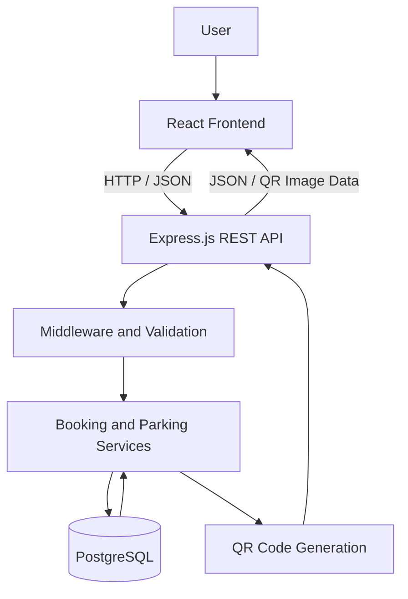

# ParkLite Backend

**Parking Management REST API | Node.js, Express.js, PostgreSQL**

ParkLite is a parking management platform designed to simplify parking discovery, reservation management, and booking confirmation. Its backend exposes RESTful APIs, persists application data in PostgreSQL, and generates QR codes associated with parking bookings.

The project focuses on practical backend engineering concepts, including API design, relational data modeling, environment-based configuration, booking workflows, and integration between a React frontend and an Express backend.

> **Project status:** Under active development. Booking APIs, PostgreSQL integration, and QR-code generation/display have been developed. QR verification at parking gates and guard check-in/check-out workflows remain in progress.

---

## Table of Contents

- Overview
- Key Features
- Technology Stack
- System Architecture
- Request Lifecycle
- Project Structure
- Database Design
- API Reference
- QR Code Workflow
- Error Handling
- Security and Configuration
- Installation and Setup
- Testing
- Deployment
- Future Roadmap

---

## Overview

ParkLite provides backend services for parking discovery and reservation management. It connects the frontend to a PostgreSQL database through REST APIs and supports booking-related workflows.

## Key Features

### Parking Management

- Retrieve parking locations through REST API endpoints.
- Store parking information in a relational database.
- Support the frontend's parking discovery workflow.
- Provide a foundation for future availability filters and parking management operations.

### Booking Management

- Create parking bookings through an API.
- Retrieve individual booking details.
- Retrieve a user's bookings, where the corresponding route and authorization are implemented.
- Support booking cancellation through the implemented endpoint.
- Persist booking information in PostgreSQL.

### QR-Based Booking Confirmation

- Generate a QR token associated with a booking.
- Generate a QR-code image from the booking token.
- Return QR information to the frontend.
- Display QR codes on booking confirmation and booking history screens.

**Current limitation:** QR generation and display are implemented, but server-side QR verification and guard check-in/check-out are not yet complete. A displayed QR code alone does not authorize entry or exit.

### Database Integration

- Store parking and booking records in PostgreSQL.
- Separate database operations from frontend presentation.
- Use environment variables to configure the database connection.
- Support persistent data across application restarts.

### Frontend Integration

The backend communicates with the React frontend through HTTP requests and JSON responses. The frontend can consume parking information, submit booking requests, retrieve booking details, and display generated QR images.

---

## Technology Stack

| Technology | Purpose |
|---|---|
| Node.js | JavaScript runtime for server-side execution |
| Express.js | HTTP server, routing, and middleware |
| PostgreSQL | Relational database for application data |
| `qrcode` | QR-code image generation |
| JavaScript | Backend application logic |
| npm | Dependency and script management |
| dotenv / environment configuration | Local configuration and secrets management |
| Git and GitHub | Version control and source-code hosting |

The actual dependencies and versions are defined in `package.json` and `package-lock.json`.

---

## System Architecture

ParkLite follows a client-server architecture. The React frontend communicates with the Express backend over HTTP, while the backend handles request processing, business logic, QR generation, and database operations.



### Architecture Responsibilities

**Frontend layer**
- Displays parking information and booking details.
- Submits requests to the backend.
- Displays booking QR codes returned by the API.

**API layer**
- Defines HTTP routes and request handling.
- Receives client input and returns structured responses.
- Connects frontend workflows to backend operations.

**Business logic layer**
- Processes parking and booking operations.
- Coordinates booking persistence and QR generation.

**Database layer**
- Stores parking and booking information.
- Provides persistent relational data storage.

**QR generation**
- Converts a booking token into a QR-code image.
- Supplies the generated image to the frontend.

This diagram represents the logical architecture; exact file-level separation depends on the current implementation.

---

## Request Lifecycle

A typical booking request follows this flow:

1. The frontend submits a booking request to the Express API.
2. Express matches the request to the relevant route.
3. The backend validates and processes the request according to the implemented business rules.
4. Booking information is persisted in PostgreSQL.
5. A booking token is used to generate a QR code.
6. The API returns the booking response to the frontend.
7. The frontend displays the booking confirmation and QR code.

A production-ready implementation should additionally enforce authorization, validate parking availability inside a database transaction, prevent overbooking under concurrent requests, and verify QR tokens server-side before allowing gate access.

---

## Project Structure

```text
parklite/
├── src/                       # React frontend
├── public/                    # Static frontend assets
├── package.json               # Frontend dependencies and scripts
├── .gitignore
│
└── parklite-backend/
    ├── database/              # Database-related files
    ├── src/                   # Express backend source
    ├── package.json           # Backend dependencies and scripts
    ├── package-lock.json
    ├── .gitignore
    └── README.md
```

The internal contents of `src/` and `database/` may vary as development continues.

---

## Database Design

PostgreSQL is used to persist parking and booking data.

### Parking Lots

The parking-lot data model supports the information needed to identify and display parking locations.

| Field | Purpose |
|---|---|
| `id` | Parking lot identifier |
| `name` | Parking lot name |
| `address` | Parking location |
| `capacity` | Total parking capacity |
| `rate` | Parking price or rate |
| `status` | Operational status |

Confirm the actual columns and data types against the database schema before treating this table as the exact implementation.

### Bookings

Booking records associate a reservation with its parking lot and booking details.

| Field | Purpose |
|---|---|
| `id` | Booking identifier |
| `parking_lot_id` | Associated parking lot |
| `vehicle_number` | Registered vehicle number |
| `qr_token` | Token associated with the booking |
| Booking status | Reservation lifecycle state, if implemented |

Additional fields may exist in the current schema. The definitive schema is the database SQL or migration files.

### Data Integrity Considerations

A robust implementation should use:

- Primary keys for unique record identification.
- Foreign keys to preserve relationships between bookings and parking lots.
- Constraints to reject invalid data.
- Database transactions for operations that must succeed or fail together.
- Concurrency-safe availability checks to prevent overbooking.

These are engineering requirements to verify against the implementation, not claims that every safeguard is already complete.

---

## REST API Reference

**Base URL (local example):**

```text
http://localhost:3000/api
```

The following table documents the routes discussed during development. Verify the exact paths, HTTP methods, middleware, and response formats against the current Express route files before relying on this as a formal API contract.

### Parking APIs

| Method | Endpoint | Description |
|---|---|---|
| `GET` | `/parking` | Retrieve parking locations |

### Booking APIs

| Method | Endpoint | Description |
|---|---|---|
| `POST` | `/bookings` | Create a booking |
| `GET` | `/bookings/my` | Retrieve the current user's bookings, if implemented |
| `GET` | `/bookings/:id` | Retrieve a booking by identifier |
| `PATCH` | `/bookings/:id/cancel` | Cancel a booking, if implemented |

The `/bookings/my` route requires a reliable way to identify the current user. Do not assume authentication or ownership checks are enforced until confirmed in the route middleware and controller.

### Example: Retrieve Parking Locations

**Request**

```http
GET /api/parking
```

**Illustrative response shape**

```json
[
  {
    "id": 1,
    "name": "Central Parking",
    "address": "Example location",
    "capacity": 50,
    "rate": 30,
    "status": "ACTIVE"
  }
]
```

This is an illustrative response shape, not a guaranteed copy of the live API response.

### Example: Create a Booking

**Request**

```http
POST /api/bookings
Content-Type: application/json
```

**Illustrative request body**

```json
{
  "parking_lot_id": 1,
  "vehicle_number": "UP32AB1234"
}
```

The actual request requirements depend on the current controller and validation logic.

A successful implementation should return a booking identifier and the details needed by the frontend to display the confirmation.

### Example: Retrieve a Booking

**Request**

```http
GET /api/bookings/123
```

The endpoint is intended to retrieve booking details. Confirm the actual response schema and ensure that access is restricted appropriately if bookings contain user or vehicle information.

### Example: Cancel a Booking

**Request**

```http
PATCH /api/bookings/123/cancel
```

If cancellation is supported by the deployed implementation, it should update the booking state and prevent subsequent operations that are no longer valid.

---

## QR Code Generation

The backend uses the `qrcode` package to create a QR-code image from a booking token.

### Current Workflow

1. A booking is created.
2. The backend associates a QR token with the booking.
3. The QR token is converted into an image.
4. The API returns QR information for frontend display.
5. The frontend displays the QR code on the confirmation and booking history screens.

The QR image can be generated from the stored token when requested; the image itself does not necessarily need to be stored in PostgreSQL.

### QR Verification Roadmap

The next stage is to implement server-side verification:

- Decode and validate scanned QR content.
- Confirm that the token belongs to a valid booking.
- Verify that the booking is eligible for entry or exit.
- Authenticate the guard or authorized operator.
- Record check-in and check-out timestamps.
- Reject expired, cancelled, invalid, or already-used tokens as appropriate.
- Make state transitions atomic to prevent duplicate processing.

These verification and guard workflows are planned work, not completed features.

---

## Error Handling

The API should return appropriate HTTP status codes based on the actual outcome of a request.

| Status | Meaning |
|---|---|
| `200 OK` | Request completed successfully |
| `201 Created` | Resource created successfully |
| `400 Bad Request` | Invalid request input |
| `401 Unauthorized` | Authentication required or invalid |
| `403 Forbidden` | Insufficient permissions |
| `404 Not Found` | Requested resource not found |
| `409 Conflict` | Conflicting state, such as a booking conflict |
| `500 Internal Server Error` | Unexpected server-side failure |

These are recommended conventions. Confirm which codes and response bodies the current implementation actually returns.

Error responses should be consistent, understandable, and free of database credentials or internal stack traces in production.

---

## Security and Environment Configuration

### Environment Variables

Create a local `.env` file inside `parklite-backend/` and use the variable names required by the code.

Example template:

```env
PORT=3000
DATABASE_URL=your_postgresql_connection_string
JWT_SECRET=your_secure_secret
```

This is a template only. Match the variables to the actual application configuration. Never add real credentials to the README.

### Security Checklist

- Keep `.env` files out of Git.
- Keep database passwords and authentication secrets private.
- Validate request bodies and path parameters.
- Restrict users to resources they are authorized to access.
- Use secure password hashing if password-based authentication is implemented.
- Validate JWTs and enforce roles if JWT-based authorization is implemented.
- Use parameterized SQL queries to reduce SQL injection risks.
- Use transactions and appropriate locking or constraints for booking concurrency.
- Configure CORS for approved frontend origins.
- Avoid returning sensitive internal errors to clients.

Authentication, role-based access control, and the above safeguards should be marked complete only after their implementation has been verified.

---

## Installation and Local Setup

### Prerequisites

- Node.js and npm
- PostgreSQL
- Git

### 1. Clone the Repository

```bash
git clone https://github.com/RAGINI-06/parklite.git
cd parklite/parklite-backend
```

### 2. Install Dependencies

```bash
npm install
```

### 3. Configure the Database

Create a PostgreSQL database and run the schema or SQL scripts provided in the project.

Set the appropriate connection variables in your local `.env` file.

### 4. Configure the Environment

Ensure that the required database URL, port, and any other application-specific variables are configured locally.

Do not commit `.env` files.

### 5. Start the Backend

Inspect the scripts in `package.json`. If the project has a `dev` script, run:

```bash
npm run dev
```

Otherwise, use the start command actually defined in `package.json`.

### 6. Verify the API

With the server running, test the parking endpoint:

```http
GET http://localhost:3000/api/parking
```

The port and route should match your actual configuration.

---

## Testing

Before deployment, test the following scenarios:

- Retrieve parking locations.
- Create a valid booking.
- Reject malformed booking requests.
- Retrieve a booking by its identifier.
- Retrieve the correct user's booking history, if supported.
- Cancel an eligible booking, if supported.
- Generate and retrieve a QR image.
- Handle unknown booking IDs.
- Handle unavailable database connections.
- Verify that invalid or unauthorized requests cannot access protected data.
- Test concurrent booking requests against the same available capacity.

Tests should be added to the project and executed before reporting these scenarios as passing.

---

## Deployment

The frontend and backend can be deployed separately while using a shared GitHub repository.

A possible deployment setup is:

- **Frontend:** Vercel
- **Backend:** Render
- **Database:** Managed PostgreSQL, such as Neon

Production configuration should include:

- A production database connection string.
- A backend port compatible with the hosting platform.
- Approved frontend origins in CORS settings.
- Frontend API configuration pointing to the deployed backend.
- Secrets configured in the hosting provider's environment settings.

Deployment is not considered complete until the live API, database connection, frontend integration, and relevant workflows have been tested.

---

## Development Roadmap

### Completed or Developed

- [x] Express backend foundation
- [x] PostgreSQL integration
- [x] Parking listing API
- [x] Booking creation and retrieval workflows
- [x] QR-token-based image generation
- [x] QR display on booking confirmation and history screens


The roadmap reflects current development goals; update the checklist as each feature is implemented and tested.

---

## Author

**Ragini Nishad**

GitHub: [RAGINI-06](https://github.com/RAGINI-06)

## License

No license has been specified. Add a license file if you intend to grant others permission to reuse, modify, or distribute this project.
